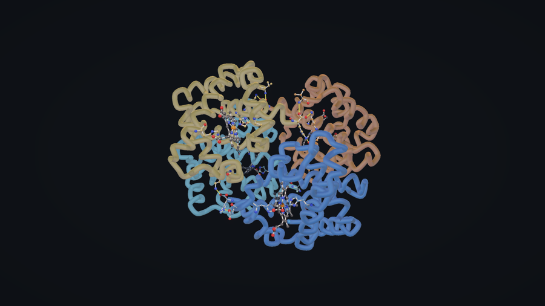
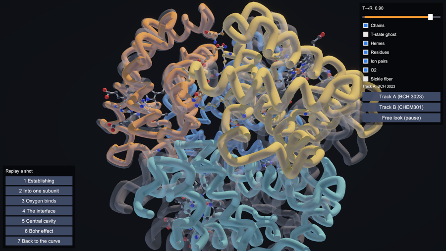

# Molecule tutorials

Interactive 3D tutorials on protein structure and mechanism for undergraduate biochemistry, built in Unity from
Protein Data Bank structures. Each tutorial exists in two forms: a narrated video and an interactive browser twin
(the same scene with the camera handed to the student, plus checkpoint questions).

| Tutorial | Twin | Structures | Status |
| --- | --- | --- | --- |
| Hemoglobin: T to R, the Bohr effect, sickle cell | [open](https://neogio73.github.io/molecule-tutorials/hemoglobin/) | 2HHB, 1HHO, 2HBS | prototype, placeholder narration timings |

## How the twin works

Orbit with the mouse or touch, scrub the **T ↔ R** slider, toggle chains, hemes, ion pairs, O₂ and the sickle
fiber, or replay any shot. Track A follows the mechanism (for a majors biochemistry course); Track B is the
structure-level version with the sickle-cell story. Nothing is recorded or sent anywhere.

## Pipeline

`pipeline/hb_prep.py` reads the PDB files, rebuilds the oxy tetramer from the crystal symmetry, superposes R on T by
the α1β1 dimer, and writes `hemoglobin.json` for Unity (Cα traces for both states, hemes, O₂, named residues, the
Lehninger Fig. 5-9 ion pairs, and the sickle double strand). `hemoglobin_report.txt` lists the numbers it measured
(α2β2 rotation 13°, Fe 0.33–0.45 Å out of the heme plane in T, ion-pair distances in T and R).

`pipeline/unity_scripts/` holds the Unity C# that turns the JSON into the scene: tube morphing, ball-and-stick,
ion-pair lines, the shot sequence, the orbit camera and the checkpoint UI. The Unity project files are not in this
repository; they are available from the author on request.

## Credits

Structures from the RCSB Protein Data Bank (2HHB Fermi & Perutz 1984; 1HHO Shaanan 1983; 2HBS Harrington et al.
1997). Residue naming and reference values follow Lehninger Principles of Biochemistry.

John Picione, Daytona State College.
